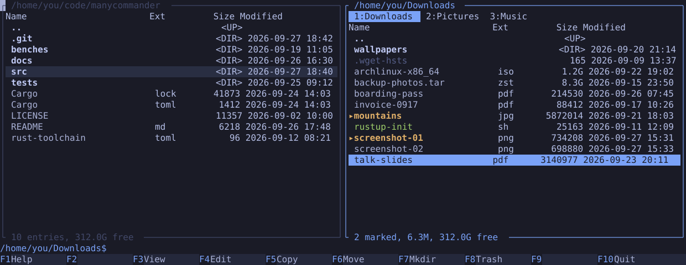

# manycommander

A dual-pane file manager for the Omarchy terminal.

Two panels, the F-key verbs and a command line, in the Total Commander tradition.
manycommander wears the active Omarchy theme and changes with it. A copy or a move
never leaves a half-written file behind.

**Documentation: [manycommander.app](https://manycommander.app)** -- install, launch, the
keymap, finding and renaming, archives, the quick view, SFTP, configuration, theming, and
what the file operations guarantee.



## Install

Any Linux distribution with kernel 6.8 and glibc 2.34 or later, on x86-64, and a terminal
with truecolor. The kitty keyboard protocol, which Ghostty, foot, Alacritty and Kitty, the
terminals Omarchy ships, all speak, adds a few chords to the keymap.

Omarchy ships [mise](https://mise.jdx.dev/), which installs the latest release and checks
it against its checksum. `omarchy update` keeps it current.

```bash
mise use -g github:manyfold-dk/manycommander
```

Without mise, install a release by hand, or build from source with a stable Rust
toolchain: [Install](https://manycommander.app/docs/install/).

## Launch

Bind it in `~/.config/hypr/bindings.lua`. `focus = true` brings a running window forward
instead of opening a second one.

```lua
o.bind("SUPER + E", "File manager (dual pane)", { tui = "manycommander", focus = true })
```

Press `Super+E`. The left panel opens in the working directory and the right one in your
home. After that, every start restores the last tabs. `F1` shows the keymap.

From a terminal: `manycommander` restores the last session, `manycommander ~/Downloads`
sets the left panel, and a second argument sets the right one.
[Launch options](https://manycommander.app/docs/launch/).

## What it does

| | |
|---|---|
| Live theme | Reads the active Omarchy palette and recolours when the theme changes. Nothing to configure. [How theming works](https://manycommander.app/docs/theme/) |
| F-keys | F3 view, F4 edit, F5 copy, F6 move, F7 mkdir, F8 trash. Marks, glob selection, quick search, tabs per panel and a shell command line (Ctrl+E) come with them. [Keymap](https://manycommander.app/docs/keys/) |
| Find and jump | Ctrl+D jumps to bookmarks and frequent directories, with zoxide's ranking merged in when it is installed; `z` does the same from the command line. Typing filters a panel, case-insensitively, and forgives a typo. Alt+F7 finds files by name and content into a results tab that every verb works on. [Find and rename](https://manycommander.app/docs/find-and-rename/) |
| Rename and compare | Ctrl+M renames many files with masks, a live preview and undo, and never overwrites. Shift+F2 marks what differs between the two panels. Alt+L creates links and Alt+A changes mode and time. |
| Copy and move | A copy is written under a temporary name and renamed into place, so a file you can see is complete. An overwrite replaces the old file atomically. Sparse files stay sparse, and hard links within the copied set stay linked. A move across filesystems deletes the source only after the copy is flushed, so a crash can leave a file in both places, never in neither. [What each operation guarantees](https://manycommander.app/docs/file-operations/) |
| Trash | F8 moves to the freedesktop.org trash, the same one Nautilus and `gio` use. It never copies across filesystems. Deleting for good is Shift+F8, and it waits until you type `delete`. [Durability after a crash](https://manycommander.app/docs/durability/) |
| Archives | Enter browses zip, tar, compressed tar (pacman's `.pkg.tar.zst` included) and 7z archives as read-only directories. F5 extracts with the copy's guarantees, and no member lands outside the destination. [Archives](https://manycommander.app/docs/archives/) |
| Quick view | Ctrl+Q shows the picture under the cursor next to the list, with kitty graphics, sixel or halfblocks, and an info card with the first lines for everything else. [Quick view](https://manycommander.app/docs/quick-view/) |
| SFTP | `cd sftp://host/dir` browses a server through your own ssh and its configuration. F5 and F6 download and upload; on a server with hard links, an upload never shows a partial file. [SFTP](https://manycommander.app/docs/sftp/) |

The optional config file is `~/.config/manycommander/config.toml`. Every key is optional.
[Configuration](https://manycommander.app/docs/configuration/).

## Development

Build with the latest stable Rust on Linux 6.8 or later: `cargo run`. Before you open a pull
request, read [CONTRIBUTING.md](CONTRIBUTING.md): it covers the check script, the tests that
need btrfs or user namespaces, and the rules the file operations keep.

| Where | What |
|---|---|
| [site/content/docs/](site/content/docs/) | User documentation, published at [manycommander.app/docs](https://manycommander.app/docs/) |
| [docs/tdr/](docs/tdr/README.md) | Technical design records: how each part works and the invariants it keeps |
| [docs/adr/](docs/adr/README.md) | Architecture decision records: why it is built this way |
| [docs/runbooks/](docs/runbooks/) | Maintainer procedures: releases, manual release checks, the AUR package, the website |
| [docs/perf/](docs/perf/history.md) | Benchmark history |

Each release on GitHub carries the x86-64 Linux tarball, with the licence texts of the crates
it is built from, its SHA-256 and a build provenance attestation. The release workflow also
builds and checks the AUR package `manycommander-bin` from [contrib/aur/](contrib/aur/). The
package is not on the AUR yet: the AUR does not accept new accounts at the moment (October
2026), so the project has no account to publish it with.

Report a vulnerability through [GitHub private vulnerability reporting](https://github.com/manyfold-dk/manycommander/security/advisories/new).
See [SECURITY.md](SECURITY.md).

## License

manycommander is an independent project for [Omarchy](https://omarchy.org/). It is licensed
under either of

- Apache License, Version 2.0 ([LICENSE-APACHE](LICENSE-APACHE) or
  <https://www.apache.org/licenses/LICENSE-2.0>)
- MIT license ([LICENSE-MIT](LICENSE-MIT) or <https://opensource.org/licenses/MIT>)

at your option.

### Contribution

Unless you explicitly state otherwise, any contribution intentionally submitted for inclusion
in the work by you, as defined in the Apache-2.0 license, shall be dual licensed as above,
without any additional terms or conditions.
